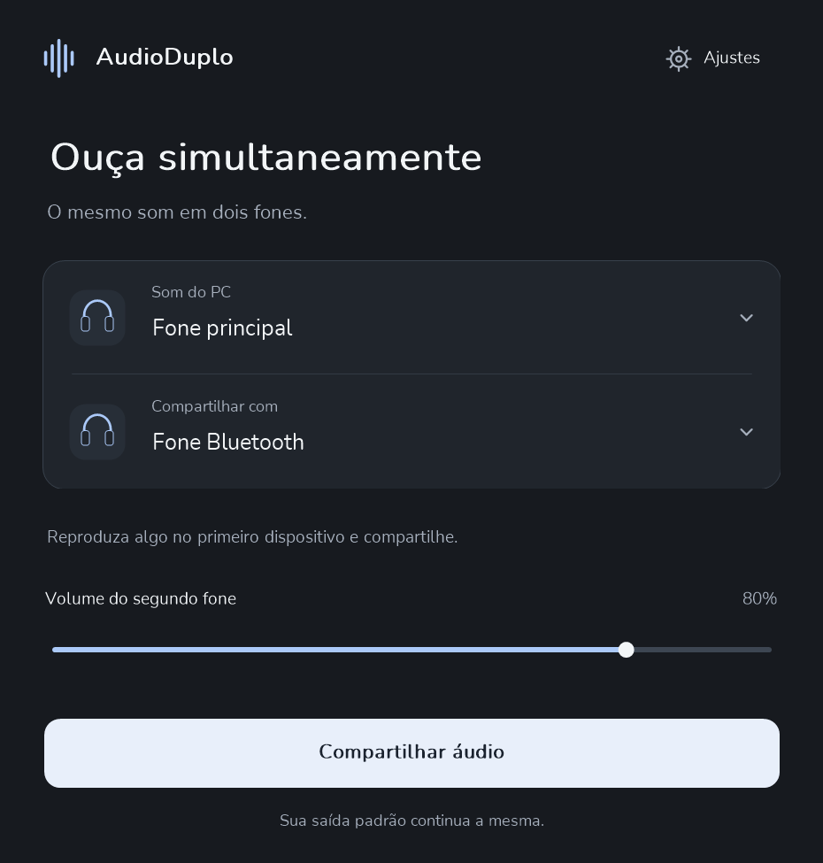
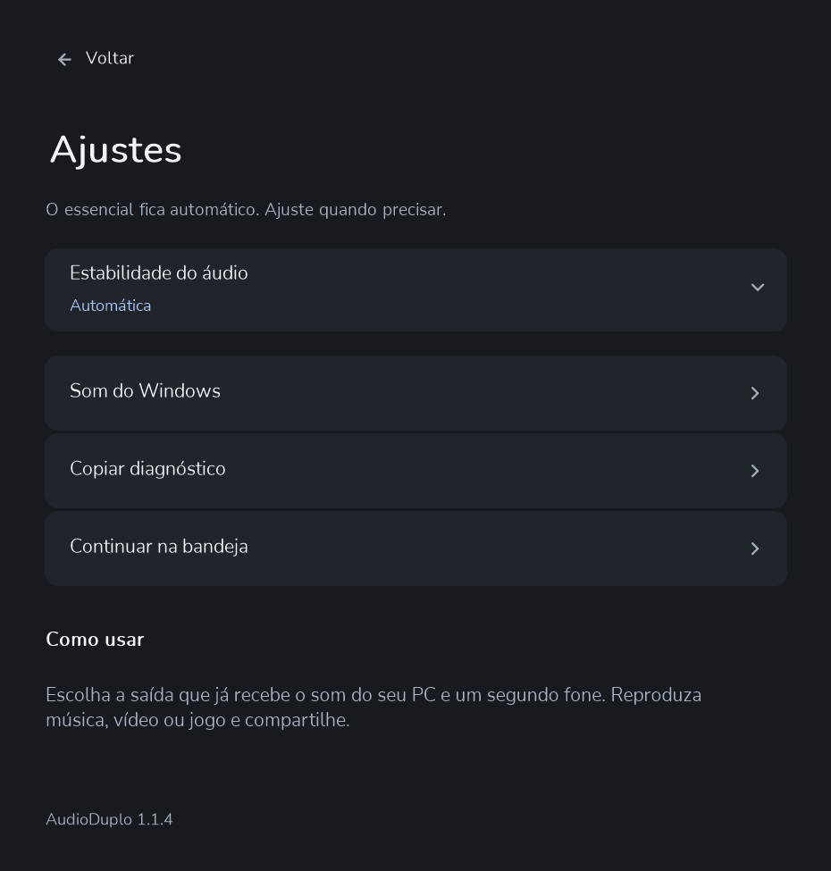

<p align="center">
  
</p>

<p align="center">
  <strong>Um som. Dois dispositivos.</strong><br>
  Aplicativo nativo para Windows · C++20 · WASAPI · Documentação em português e inglês
</p>

<p align="center">
  <a href="docs/README.en.md">English</a> ·
  <a href="docs/ARCHITECTURE.md">Arquitetura</a> ·
  <a href="docs/COMPATIBILITY.md">Compatibilidade</a> ·
  <a href="docs/VALIDATION.md">Validação</a>
</p>

<p align="center">
  
</p>

## Sobre

O AudioDuplo replica o áudio que já está tocando em uma saída do Windows para uma segunda saída. O primeiro dispositivo mantém seu caminho original. O projeto explora captura e reprodução de áudio em tempo real, sincronização entre dispositivos e uma interface desktop acessível por mouse e teclado.

## Destaques

- Captura loopback e reprodução com WASAPI em modo compartilhado.
- Saídas reconhecidas pelo Windows, incluindo Bluetooth, USB, P2, HDMI e DisplayPort.
- Conversão para estéreo float a 48 kHz e ajuste suave de volume no segundo destino.
- Buffer adaptativo de 20–80 ms, com ajuste manual de até 160 ms.
- Detecção de desconexão, preferências locais, diagnóstico sob demanda e ícone na bandeja.
- Interface Win32 compacta, atalhos de teclado e respeito à preferência de movimento reduzido.
- Sem driver virtual, gravação em disco, telemetria ou serviço em segundo plano.

## Capturas

As prévias são renderizadas pelo mesmo código de desenho usado pela aplicação. Elas mostram estados ilustrativos e não substituem a validação interativa em uma instalação do Windows.

<p align="center">
  
  &nbsp;&nbsp;
  
</p>

## Baixar e usar

Quando um lançamento estiver publicado, baixe o ZIP portátil Windows x64 na seção [Releases](../../releases), extraia-o e abra `AudioDuplo.exe`. Requer Windows 10 versão 1703 ou posterior, Windows 11 e duas saídas de áudio ativas.

1. Em **Som do PC**, escolha a saída que o player já está usando.
2. Em **Compartilhar com**, selecione a segunda saída.
3. Inicie o áudio no player e clique em **Compartilhar áudio**.

O aplicativo não altera o dispositivo padrão do Windows. Compatibilidade depende do endpoint, driver, adaptador e hardware. Bluetooth pode acrescentar atraso; sincronismo acústico perfeito não é prometido. Veja os [limites e a matriz de compatibilidade](docs/COMPATIBILITY.md).

## Compilar

Requer Visual Studio 2022 ou posterior com ferramentas C++, Windows SDK e CMake 3.21 ou posterior.

```powershell
.\scripts\Build.ps1 -Package
```

O script compila Release x64, executa as suítes automatizadas e prepara o pacote portátil e o checksum SHA-256. A compilação e os testes estão documentados em [Validação](docs/VALIDATION.md); a arquitetura do motor e da interface está em [docs/ARCHITECTURE.md](docs/ARCHITECTURE.md).

## Estado de validação

A revisão local 1.1.4 documenta compilação Release e três suítes automatizadas aprovadas. Escuta prolongada em dois dispositivos, reconexão, suspensão, acessibilidade interativa, renderização em monitor físico e execução de CI remoto ainda precisam de validação manual. O executável atual não tem assinatura digital. Consulte a [matriz completa](docs/VALIDATION.md) antes de interpretar os resultados.

## Origem, licença e atribuição

Esta edição deriva de uma cópia independente do **Áudio Duplo V4 QCY**, fornecida pelo proprietário do projeto para adaptação. A arquitetura de áudio, o ring SPSC e o resampler com estado têm essa origem; interface, testes, documentação, compatibilidade genérica e distribuição foram evoluídos nesta edição. Os termos de uso e a atribuição da base precisam ser respeitados conforme a autorização original.

O pacote inclui a licença [MIT](LICENSE) e avisos de origem e de terceiros em [`NOTICE.md`](NOTICE.md). Fontes incorporadas têm licenças SIL Open Font License incluídas no código e no pacote portátil.

Veja também o [histórico de alterações](CHANGELOG.md), [como contribuir](CONTRIBUTING.md) e [como preparar uma publicação](docs/PUBLISHING.md).
